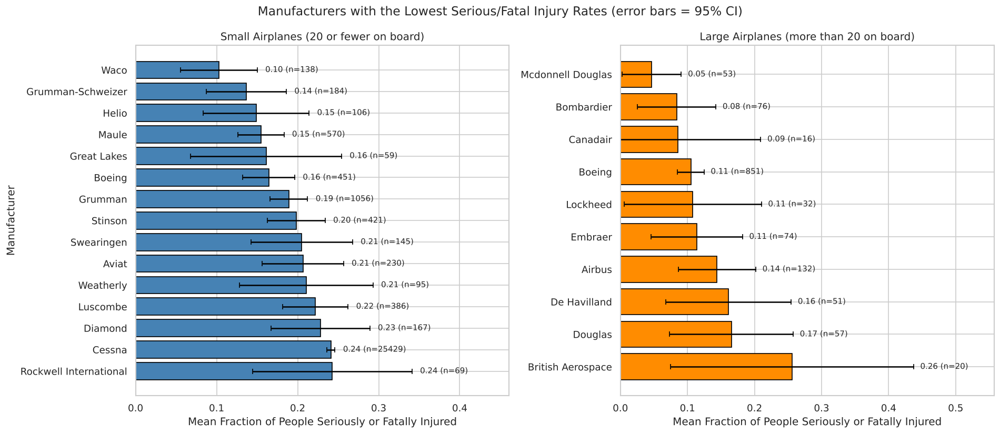
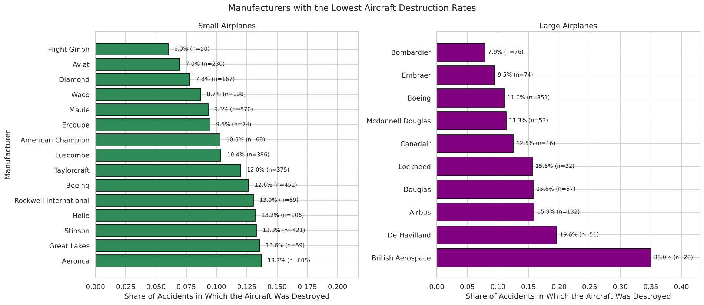
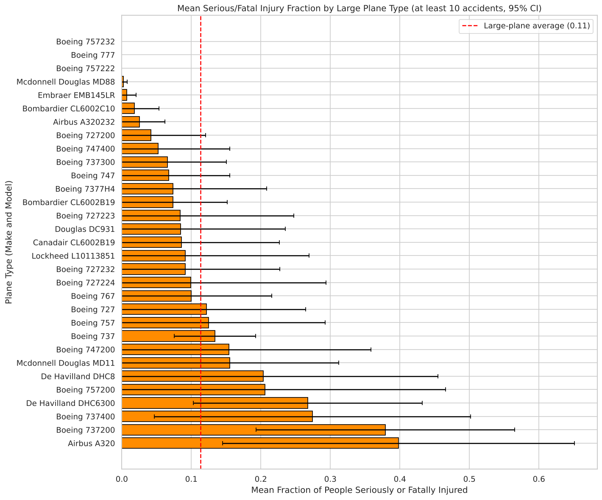
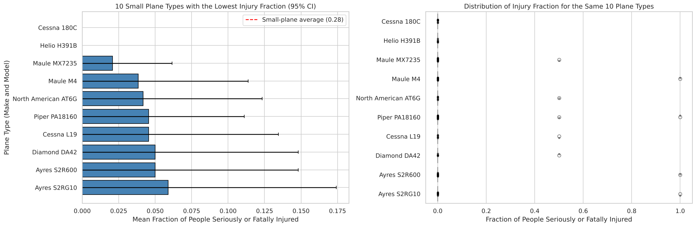
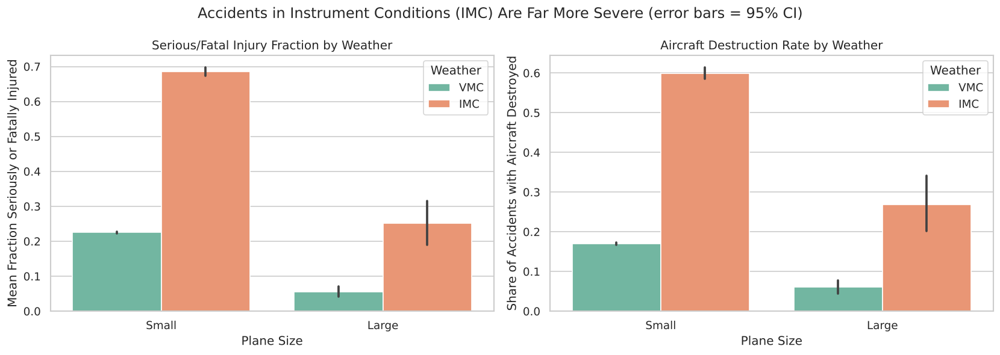
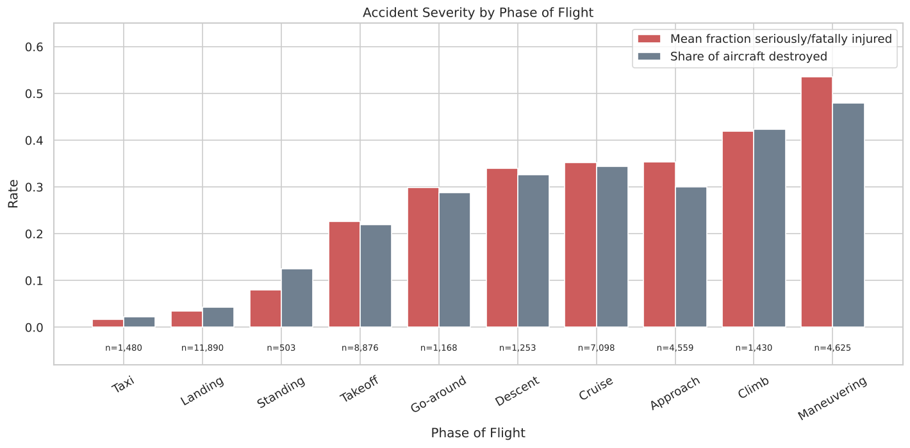

# Aviation Accident Analysis: Which Airplanes Are Safest to Insure?

## Business Problem

An airline and airplane insurer wants to know which aircraft **makes and models** have a **low chance of being destroyed** and a **low likelihood of fatal or serious injury** to the people on board when an accident happens. The insurer also wants to understand **which conditions** make accidents more severe.

The scope, set by the client:
- **Professionally built** airplanes only (no homebuilt aircraft).
- Aircraft that could **still be in service**: assuming a 40-year lifespan, only accidents from **1983 onwards**.
- **Separate recommendations** for small airplanes and large passenger airplanes.
- Claims must be **statistically robust**, based on enough accidents to compare groups fairly.

## Data

The data comes from the [NTSB aviation accident database](https://www.kaggle.com/datasets/mos3santos/acidentes-de-aviao-at-2023) (88,889 events, 1948–2022). After cleaning and filtering, the analysis uses **59,434 airplane accidents** from 1983 onwards across **58 manufacturers**.

## Repository Structure

```
├── Aviation_Accidents_Cleaning.ipynb       # Part 1: loading, filtering, cleaning, derived measures
├── Aviation_Accidents_Data_Analysis.ipynb  # Part 2: EDA, recommendations, factor analysis
├── data/
│   ├── AviationData.csv                    # raw data
│   └── AviationData_Cleaned.csv            # cleaned data produced by Part 1
├── images/                                 # key charts used in this README
└── README.md
```

## Methods

**Cleaning ([Aviation_Accidents_Cleaning.ipynb](Aviation_Accidents_Cleaning.ipynb))**
- Kept events from 1983 onwards and professionally built aircraft only.
- **Standardized manufacturer names**, e.g. `CESSNA`, `Cessna Aircraft Co.` and `Cessna Aircraft Company` all became `Cessna`, and `Dehavilland` became `De Havilland`.
- `Aircraft.Category` was missing for 64% of rows. Missing categories were **filled in as Airplane** for manufacturers whose known records are at least 90% airplanes. This kept about 44,000 accidents that would otherwise have been lost, without mislabelling helicopter makers.
- Built two key measures:
  - **`Frac.Serious.Fatal`**: the share of people on board who were seriously or fatally injured (people on board = fatal + serious + minor + uninjured).
  - **`Destroyed`**: 1 if the aircraft was destroyed, 0 otherwise. Its average is the **destruction rate**.
- Kept manufacturers with at least 50 accidents, created a unique **`Make.Model`** plane-type ID, cleaned placeholder values (e.g. `UNK`, `Unknown`, 0 engines) in the weather, engine, purpose and phase columns, and dropped columns with 20,000 or fewer non-null values.

**Analysis ([Aviation_Accidents_Data_Analysis.ipynb](Aviation_Accidents_Data_Analysis.ipynb))**
- **Small vs. large planes** (threshold of 20 people on board) is decided per plane type, using the **75th percentile** of people on board. This avoids errors from mid-air collision records (small planes logged with 100+ people) and from cargo flights (airliners with only a few crew on board).
- Manufacturers were compared only with enough data: at least **50 accidents** (small) or **10** (large); plane types needed at least **10 accidents**. Charts show **95% confidence intervals**.
- Factors were tested with **chi-square** and **Mann-Whitney** tests.

## Results

### Manufacturers





| Group | Recommended manufacturers | Injury fraction | Destruction rate | Accidents |
|---|---|---|---|---|
| **Small** (average: 0.276 / 21.3%) | **Maule** | 0.155 | 9.3% | 570 |
| | **Aviat** | 0.207 | 7.0% | 230 |
| | **Diamond** | 0.228 | 7.8% | 167 |
| **Large** (average: 0.114 / 12.4%) | **Boeing** | 0.105 | 11.0% | 851 |
| | **Bombardier** | 0.084 | 7.9% | 76 |
| | **Embraer** | 0.114 | 9.5% | 74 |

### Specific Plane Types





- **Large planes:** the **Boeing 777** (24 accidents) recorded no serious or fatal injuries. The **Boeing 757** variants, **McDonnell Douglas MD-88**, **Embraer EMB-145LR**, **Bombardier CRJ (CL-600-2C10)** and **Airbus A320-232** all had injury fractions under 0.03 and **no aircraft destroyed**.
- **Small planes:** the **Maule MX-7-235**, **Maule M-4**, **Piper PA-18-160 Super Cub**, **Cessna 180A** and **Diamond DA42** combine very low injury fractions (0.02–0.07) with destruction rates of 0–4%.

### Factors That Affect Accident Severity



**1. Weather is the strongest factor.** In instrument conditions (IMC, poor visibility), small planes had a mean injury fraction of **0.685** against **0.225** in visual conditions (VMC), and were destroyed in **59.9%** of accidents against **17.0%**. Large planes show the same pattern (0.251 vs 0.056). *p < 0.001*



**2. Phase of flight matters.** Taxi (0.016) and landing (0.035) accidents are rarely serious, while **maneuvering** (0.536 injury, 48.0% destroyed) and **climb** (0.419, 42.4%) are the most severe. *p < 0.001*

**3. Engines.** **Turbofan** aircraft have the best outcomes (0.114 injury, 11.6% destroyed). Twin-engine small planes are *not* safer than single-engine ones. They are more often flown in IMC (20.0% of their accidents vs 6.3%), which helps explain their higher severity.

## Recommendations

1. **Small airplanes:** favour **Maule**, **Aviat** and **Diamond** aircraft, especially the **Maule MX-7-235 / M-4**, **Piper PA-18-160 Super Cub**, **Cessna 180A** and **Diamond DA42**.
2. **Large airplanes:** favour **Boeing**, **Bombardier** and **Embraer**, especially the **Boeing 777 and 757**, **Bombardier CRJ** and **Embraer EMB-145**.
3. **Price the conditions, not just the aircraft:** operators who often fly in **instrument conditions** or do a lot of **low-level maneuvering** (e.g. aerial application, banner towing) carry much higher severity risk.

## Limitations and Next Steps

- The data only contains **accidents**, not total flights or flight hours, so these figures describe **how severe an accident is likely to be**, not **how likely an accident is**. Combining this with fleet-size or flight-hour data would give true accident rates.
- Some plane types have only 10–25 accidents, so their estimates are less certain than the manufacturer-level results.
- Next steps: add flight-hour exposure data, look at trends over time, and model several factors together (e.g. weather and phase of flight) to separate their effects.
